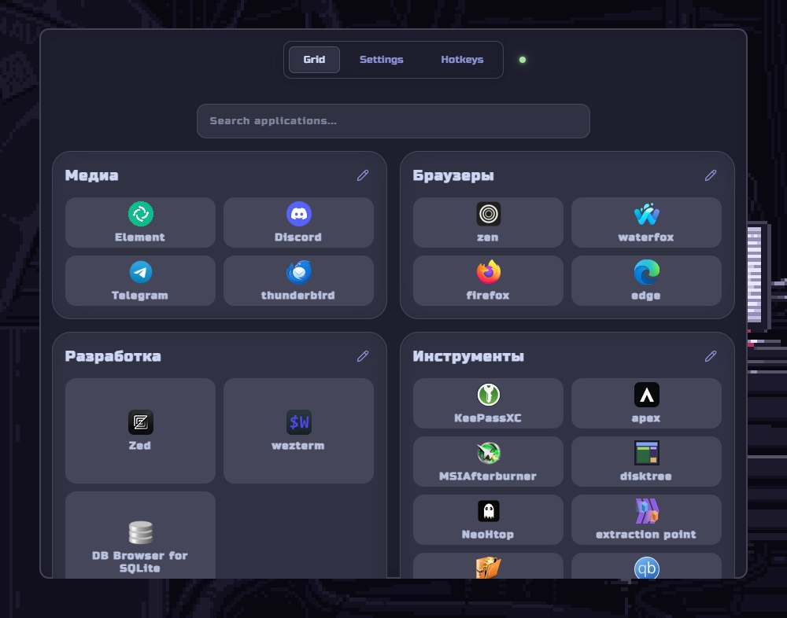

<!--  -->

# Robento

An open-source Windows application that helps you organize your programs in a convenient quick-access panel.

Create groups, add shortcuts, customize icons, rearrange items with simple drag and drop, and launch your favorite applications in just a few clicks.

Spend less time searching for applications and keep your workspace organized.

Supported languages: English and Russian.



# Hotkeys

| Action                    |   Shortcut    |
| :------------------------ | :-----------: |
| Create a new group        |  `Shift + G`  |
| Edit the selected group   |      `R`      |
| Delete the selected group |  `Shift + R`  |
| Show / hide the window    | `Alt + Space` |

# Tech Stack

<table>
<tr>
<td>

</td>
<td>

</td>
<td>

</td>
<td>

</td>
<td>

</td>
</tr>
</table>

# Installation

Go to the [Releases](https://github.com/Nevionn/Robento/releases) section and download the executable file.

# Building from Source

## Requirements

- Node.js: v22.x or higher ([Download](https://nodejs.org/en))
- Rust ([Install](https://rust-lang.org/tools/install/))

```bash
git clone https://github.com/Nevionn/Robento.git

cd Robento

pnpm install

pnpm tauri dev
```

# Links ❤️

[](https://t.me/ancient_nevionn)
[](https://www.donationalerts.com/r/nevion)
