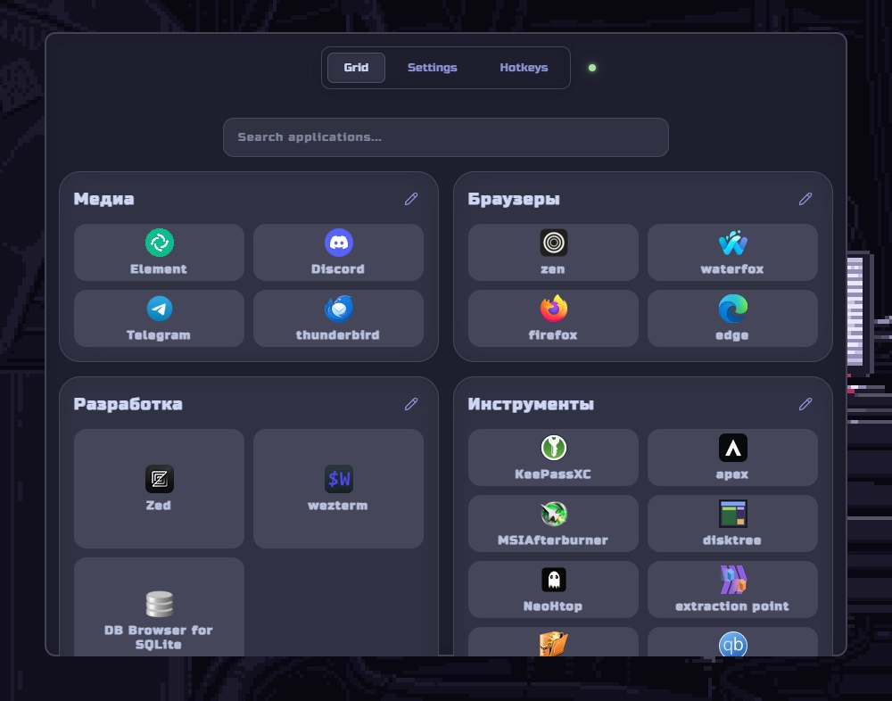

<!---->


# Robento

Открытое приложение для Windows, которое помогает организовать программы в удобную панель быстрого доступа.

Создавайте группы, добавляйте ярлыки, настраивайте иконки, меняйте расположение элементов простым перетаскиванием и запускайте нужные программы в пару кликов.

Меньше времени на поиск нужных приложений — больше порядка на рабочем пространстве.
Поддержка языков: русский и английский.

# Горячие клавиши

| Действие                       | Сочетание клавиш |
| :----------------------------- | :--------------: |
| Создать новую группу           |   `Shift + G`    |
| Редактировать выбранную группу |       `R`        |
| Удалить выбранную группу       |   `Shift + R`    |
| Открыть / свернуть окно        |  `Alt + Space`   |

# Стек технологий

<table>
<tr>
<td>

</td>
<td>

</td>
<td>

</td>
<td>

</td>
<td>

</td>
</tr>
</table>

# Установка

Перейти в раздел [релиз](https://github.com/Nevionn/Robento/releases) и скачать исполняемый файл

# Установка из исходников

## Зависимости

- Node.js: v22.x или выше ([Установить](https://nodejs.org/en))
- Rust ([Установить](https://rust-lang.org/tools/install/))

```bush
git clone https://github.com/Nevionn/Robento.git

cd Robento

pnpm install

pnpm tauri dev
```

# ССЫЛКИ ❤️

[](https://t.me/ancient_nevionn)
[](https://www.donationalerts.com/r/nevion)
